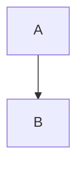

- [x] task item
- [ ] unchecked

$x^2 + y^2 = z^2$

:smile: :fire: :rocket:

:tada: :rocket: :octocat:

> [!NOTE]
> This is a note

> [!WARNING]
> Watch out

> This is
> hahaha

`int main()`

A footnote[^1]

[^1]: The footnote text